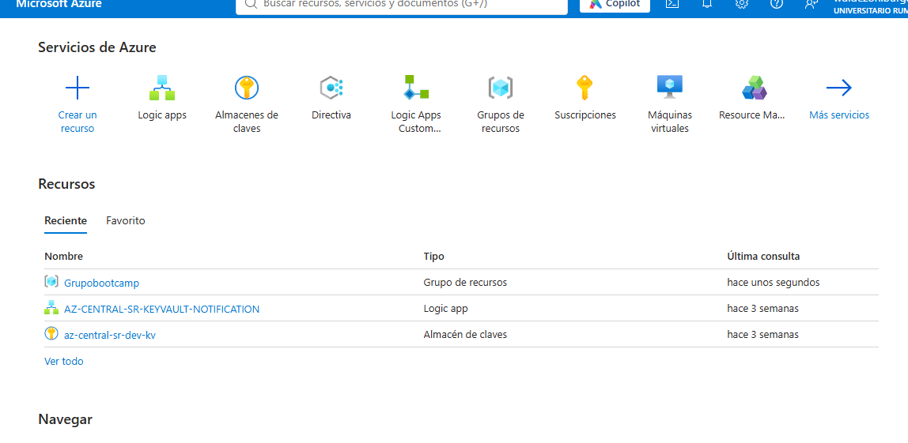

# Proyecto Final - Azure Bootcamp (LEAD UTP & Microsoft)

**Autor:** Wuidezon Isaías Burga Cabascango ([@isaiasDev](https://github.com/isaiasDev))

## Resumen técnico

Este proyecto integra recursos de Azure para demostrar gobierno de recursos,
seguridad, automatización, infraestructura como código, CI/CD y generación de
contenido mediante agentes de IA. El grupo de recursos de referencia es
`Grupobootcamp`, en la región `eastus`.

La arquitectura considera los siguientes componentes:

- **Azure Key Vault:** `az-central-sr-dev-kv`, como almacén central de secretos.
- **Logic App:** `AZ-CENTRAL-SR-KEYVAULT-NOTIFICATION`, para automatizar
  notificaciones relacionadas con Key Vault.
- **Azure AI Foundry:** endpoint configurado para generar contenido con el
  despliegue `gpt-4o`.
- **Agentes de IA:** aplicación FastAPI con un flujo LangGraph de dos agentes.
  El Match Agent puntúa campañas activas según intereses y señales RFM; el
  Creative Agent prepara un email personalizado y un prompt de imagen.
- **Bicep y GitHub Actions:** infraestructura declarativa y workflow para
  validar y desplegar los recursos definidos en el template.

Los nombres de los recursos de Key Vault, Logic App y AI Foundry corresponden a
la configuración de Azure Portal proporcionada para este proyecto. El template
Bicep actual despliega un App Service Plan Linux Free (F1) y una Storage Account
`Standard_LRS`; no crea el Key Vault, la Logic App ni la aplicación web. El
workflow despliega los recursos del template en un grupo de recursos existente.

## Módulos cubiertos

### Gobierno y Resource Groups

Los recursos se organizan en el grupo `Grupobootcamp`, lo que permite gestionar
acceso, costos y ciclo de vida desde una unidad de administración de Azure.
Comprueba la suscripción y región seleccionadas antes de ejecutar despliegues.

### Seguridad con Key Vault

El almacén de referencia es `az-central-sr-dev-kv`, con URL
`https://az-central-sr-dev-kv.vault.azure.net/`. Guarda claves y otros secretos
en Key Vault; no los incluyas en el repositorio ni en `.env.example`.

La API de ejemplo todavía no obtiene secretos desde Key Vault. La conexión y
autorización de la aplicación con Azure Identity deben configurarse antes de
usar este recurso como proveedor de credenciales en ejecución.

### Automatización con Logic Apps

La Logic App `AZ-CENTRAL-SR-KEYVAULT-NOTIFICATION` representa el flujo de
notificaciones del proyecto. Su implementación/configuración se administra en
Azure Portal; el Bicep incluido actualmente no la aprovisiona.

### Bicep IaC

`infra/main.bicep` declara un App Service Plan Linux Free (F1) y una cuenta de
Storage `Standard_LRS` con acceso público a blobs deshabilitado y TLS 1.2
mínimo. El despliegue es incremental y requiere que el grupo de recursos exista.

### GitHub Actions CI/CD

`.github/workflows/deploy.yml` compila el template Bicep en pull requests y
puede desplegar la infraestructura en push a `main` o mediante ejecución
manual. El acceso a Azure utiliza OIDC; no se recomienda almacenar credenciales
de servicio como secretos de larga duración.

### Agentes de IA Generativa en Azure AI Foundry

El flujo de `src/agents.py` coordina el matching y la creación de contenido con
LangGraph. Puede usar un endpoint compatible con OpenAI en Azure AI Foundry.
La aplicación también ofrece generación local determinista si no se configura
el endpoint. El catálogo JSON se consulta localmente y el matching por
metadatos es una recuperación sencilla (RAG-like), no un servicio vectorial
administrado.

## 📸 Evidencia de Recursos en Azure Portal



## Configuración y ejecución local

Requisitos: Python 3.10 o posterior y Git. En PowerShell, desde la raíz del
repositorio:

```powershell
py -3 -m venv .venv
.\.venv\Scripts\Activate.ps1
python -m pip install --upgrade pip
pip install -r requirements.txt
Copy-Item .env.example .env
```

El archivo `.env.example` documenta el grupo, región, Key Vault, Logic App y
endpoint/despliegue de Foundry. No contiene secretos. Para que el generador
remoto actualmente implementado en `src/agents.py` use Foundry, configura
además en el archivo `.env` local:

```dotenv
AZURE_AI_FOUNDRY_API_KEY="<clave-del-modelo>"
AZURE_AI_FOUNDRY_MODEL="gpt-4o"
```

El código utiliza `AZURE_AI_FOUNDRY_MODEL` como nombre del despliegue; el valor
puede copiarse de `AZURE_OPENAI_DEPLOYMENT_NAME`. Si dejas
`AZURE_AI_FOUNDRY_ENDPOINT` vacío, se usa el generador local sin credenciales.
No subas `.env` a Git.

Inicia la API:

```powershell
uvicorn src.main:app --reload
```

La API estará disponible en `http://127.0.0.1:8000`, con documentación
interactiva en `/docs` y estado en `/health`. Ejemplo de solicitud:

```powershell
Invoke-RestMethod `
  -Method Post `
  -Uri http://127.0.0.1:8000/campaigns/recommendations `
  -ContentType "application/json" `
  -Body '{"dni":"48271635"}'
```

Ejecuta las pruebas:

```powershell
python -m unittest discover -s tests -v
```

## Validación y despliegue en Azure

### Validar Bicep localmente

Instala Azure CLI y Bicep, luego ejecuta:

```powershell
az login
az account set --subscription "<subscription-id>"
az bicep build --file infra/main.bicep
az deployment group validate `
  --resource-group Grupobootcamp `
  --template-file infra/main.bicep `
  --parameters storageAccountName="<nombre-global-unico>"
```

El nombre de Storage debe ser globalmente único, de 3 a 24 caracteres y
contener solo letras minúsculas y números.

### Desplegar desde GitHub Actions

1. Configura una identidad de Microsoft Entra con federación OIDC para este
   repositorio y el environment de GitHub `azure-production`. Asígnale permisos
   limitados al grupo `Grupobootcamp`.
2. En **Settings → Secrets and variables → Actions**, configura los secretos
   `AZURE_CLIENT_ID`, `AZURE_TENANT_ID` y `AZURE_SUBSCRIPTION_ID`.
3. Configura las variables `AZURE_RESOURCE_GROUP=Grupobootcamp`,
   `AZURE_LOCATION=eastus` y `AZURE_STORAGE_ACCOUNT_NAME` con el nombre único de
   la cuenta de Storage.
4. Ejecuta **Validate and deploy Azure infrastructure** manualmente o haz push
   a `main` con cambios en `infra/`. Los pull requests solo validan el template.

El workflow requiere que `Grupobootcamp` exista previamente. Este despliegue
aprovisiona únicamente los recursos declarados en `infra/main.bicep`; no publica
el código FastAPI ni crea/configura Key Vault, Logic Apps o Azure AI Foundry.
